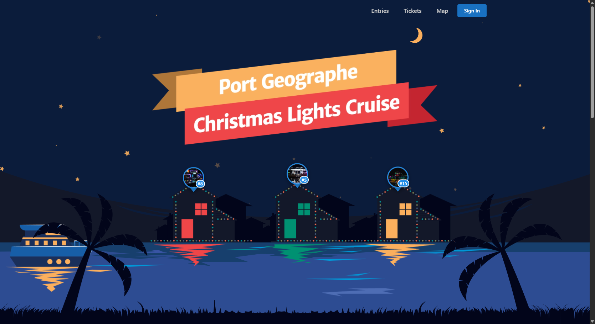

# Port Geographe Christmas Lights Cruise

A web application for the Port Geographe Christmas Lights competition and boat cruise event. Allows residents to register their decorated homes, visitors to view entries on an interactive map, and participate in community voting.

## Tech Stack

- **Frontend:** React + Vite + Mantine UI
- **Backend:** Convex (real-time database & serverless functions)
- **Package Manager:** Bun
- **Maps:** Google Maps integration
- **Auth:** Convex Auth

## Key Features

- Entry registration with photo uploads and geocoding
- Interactive map displaying all competition entries
- Community voting system
- Admin dashboard for managing entries and votes
- Email notifications
- Mobile-responsive design

## Development

This project uses [bun](https://bun.com/) for its package management so make sure you get that [installed](https://bun.com/) first.

```bash
# Install dependencies
bun install

# Run dev servers
bun run dev

# (in a separate terminal) run typecheck
bun run dev:ts
```

This will start the project up. The first time it runs it will ask you to setup a convex project, choose cloud (tho local might work too).

### Google Maps

The map uses Google Maps, to get that working you need to add `VITE_GOOGLE_MAPS_API_KEY` to the `.env.local`. To get one please see: https://developers.google.com/maps/documentation/embed/get-api-key

### Auth

This is a [convex auth](https://labs.convex.dev/auth) project, so make sure you run the init:

```bash
bunx @convex-dev/auth
```

Accept the defaults, this will add a few needed environment variables.

People can sign in two ways: with Google, or with a 6-digit code sent to their email (handy for ARG staff, whose Outlook addresses aren't Google accounts). Both end up as the same user if the email matches, ignoring case.

For Google, follow the steps here to set up a Google project and add `AUTH_GOOGLE_ID` and `AUTH_GOOGLE_SECRET` to the Convex deployment: https://labs.convex.dev/auth/config/oauth/google.

Email codes go out through Resend like the other emails, so the deployment needs `RESEND_API_KEY`. A code lasts 10 minutes, and each email can ask for 5 in a row, then one every 6 minutes.

Emails saved before this were matched exactly, so run this once on each deployment after deploying it, to lower-case them:

```bash
bunx convex run internal/users:normalizeEmails
```

#### Seeing codes on dev

Resend won't send from dev, so set `AUTH_LOG_SIGNIN_CODES=true` on the dev deployment and the codes appear in the Convex logs (`bunx convex logs`) instead of being emailed. Never set it on production. It's ignored anyway when `SITE_URL` is missing or is portgeochristmascruise.com.au, and the code is emailed as usual.

#### Off-season sign-up lock

Outside the season two flags close sign-ups:

- `IS_SIGNUP_DISABLED=true` on the Convex deployment. This is the actual lock: existing accounts (admins included) can still sign in with Google or an email code, but neither can create new ones.
- `VITE_IS_SIGNUP_DISABLED=true` in the frontend build. This only swaps the sign-in page for an "under construction" message. Admins can still reach the sign-in options at `/signin?returnTo=/admin&unlock=true`.

Turn both off when sign-ups open.

#### Letting named people in, and making admins

Two more Convex env vars, each a comma-separated list of emails. Case and spaces around each email don't matter.

- `SIGNUP_ALLOWED_EMAILS`: these people can create an account even while `IS_SIGNUP_DISABLED` is on.
- `COMPETITION_ADMIN_EMAILS`: these people are made competition admins when they sign in, with Google or a code. They can create an account while sign-ups are closed too, so there's no need to list them twice. Taking someone off the list doesn't remove the role; do that on the admin users page.

For example: `COMPETITION_ADMIN_EMAILS=ZOliver@aigleroyal.com.au, TJulian@aigleroyal.com.au`. Send them to `/signin?returnTo=/admin&unlock=true` while the sign-in page is switched off.

### Voting

Everyone gets one vote per competition, which they can change or remove until voting closes. Entrants can't vote for their own entry. A vote counts for In-Person Favourites and People's Choice when it's in person, and People's Choice only when it isn't.

The QR code on each house sign goes to `/v/<number>`, which opens this year's entry with that number. The QR code on the boat goes to `/vote`, where people type the number on the sign.

#### The in-person check

Convex can't see a voter's IP address, but the Cloudflare Worker can. `GET /api/geo` on the worker returns a token with Cloudflare's guess at where the visitor is (country, region, city, coordinates, timezone), signed with `GEO_TOKEN_SECRET` and good for 15 minutes. The vote mutation checks the signature and the age. A vote is in person only when the token is genuine, the country is in the competition's list (AU by default, and admins can narrow it to WA on the Vote Management page) and the voter ticks "I've seen this display in person". The location is saved on the vote so admins can review it.

The worker and Convex need the same secret. If either is missing, nobody's vote counts as in person and the vote page says so. Generate one with `openssl rand -base64 32`, then:

```bash
# Production: the worker secret, then the Convex env var
bunx wrangler secret put GEO_TOKEN_SECRET
npx convex env set GEO_TOKEN_SECRET '<the same secret>' --prod
```

For local dev, put `GEO_TOKEN_SECRET=<secret>` in `.dev.vars` (gitignored, read by the Vite Cloudflare plugin) and set the same value on your dev deployment with `npx convex env set GEO_TOKEN_SECRET '<secret>'`. Locally, Cloudflare's location is a guess from your own connection.

### Testing

To typecheck the project and run the unit tests:

```bash
bun run test
```

CI runs this, plus `bun run lint` and `bun run format:check`, on every push and pull request to `main`.

### OG Tag

To make OG tags work (sharing on facebook etc) this project uses a tag-injection cloudflare worker (this project is hosted on cloudflare workers).

Thus `VITE_CONVEX_SITE_URL` is defined in `.env.local` which points to your deployment site url e.g. https://blessed-meadowlark-999.convex.site you will need to update this when going to production too.

### Todo

- Support videos for entries
