# The entry machine

A competition entry's lifecycle, as `convex/features/entries/machine.ts` defines it. Generated by `bun scripts/entry-diagram.ts`: don't edit it by hand.

The owner is the entrant, the admin is a competition admin, and `server` is the submit action reporting back once it has looked the address up with Google. Each state lists the data it keeps.

```mermaid
stateDiagram-v2
  direction LR
  state "draft" as draft
  draft : houseAddress?, name?, entryNumber?
  state "submitting" as submitting
  submitting : houseAddress, name, entryNumber?
  state "submitted" as submitted
  submitted : submittedAt, houseAddress, name, entryNumber?
  state "approved" as approved
  approved : submittedAt, approvedAt, entryNumber, houseAddress, name
  state "rejected" as rejected
  rejected : rejectedAt, rejectedReason, submittedAt, houseAddress, name, entryNumber?
  [*] --> draft : ENTER (owner) [entriesOpen, notEnteredYet] / startDraft
  draft --> draft : EDIT(name?, houseAddress?) (owner) / edit
  draft --> submitting : SUBMIT (owner) [entriesOpen, hasAddress, hasName, addressIsFree] / startSubmitting
  draft --> draft : SET_NUMBER(entryNumber) (admin) [numberIsFree] / setNumber
  draft --> draft : RENUMBER(entryNumber) (server) / setNumber
  draft --> draft : LINK_PREVIOUS(previousEntryId) (admin) [isEarlierApprovedEntry, previousNumberIsFree] / linkPrevious
  submitting --> submitted : GEOCODED(lat, lng, placeId) (server) [addressIsFree, withinBoundary] / finishSubmission
  submitting --> draft : SUBMIT_FAILED (server) / backToDraft
  submitting --> draft : TIMED_OUT after 10 minutes / backToDraft
  submitting --> submitting : SET_NUMBER(entryNumber) (admin) [numberIsFree] / setNumber
  submitting --> submitting : RENUMBER(entryNumber) (server) / setNumber
  submitting --> submitting : LINK_PREVIOUS(previousEntryId) (admin) [isEarlierApprovedEntry, previousNumberIsFree] / linkPrevious
  submitted --> approved : APPROVE (admin) / approve
  submitted --> rejected : REJECT(rejectedReason) (admin) / reject
  submitted --> submitted : SET_NUMBER(entryNumber) (admin) [numberIsFree] / setNumber
  submitted --> submitted : RENUMBER(entryNumber) (server) / setNumber
  submitted --> submitted : LINK_PREVIOUS(previousEntryId) (admin) [isEarlierApprovedEntry, previousNumberIsFree] / linkPrevious
  approved --> approved : RENAME(name) (owner) / rename
  approved --> approved : SET_NUMBER(entryNumber) (admin) [numberIsFree] / setNumber
  approved --> approved : RENUMBER(entryNumber) (server) / setNumber
  approved --> approved : LINK_PREVIOUS(previousEntryId) (admin) [isEarlierApprovedEntry, previousNumberIsFree] / linkPrevious
  rejected --> submitted : REOPEN (admin) / reopen
```

